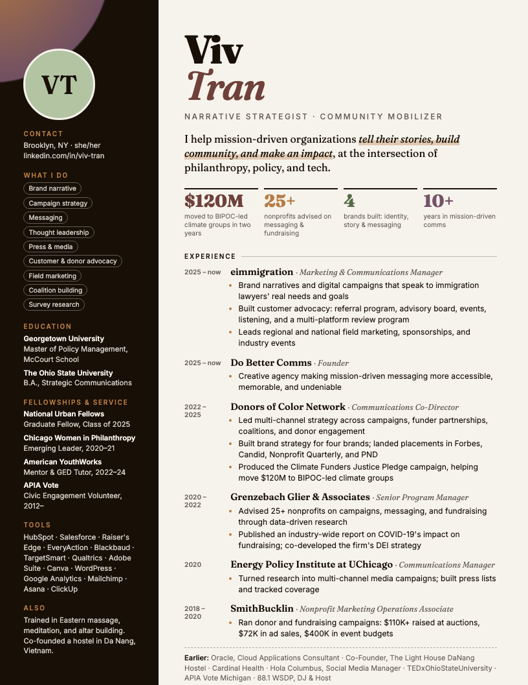
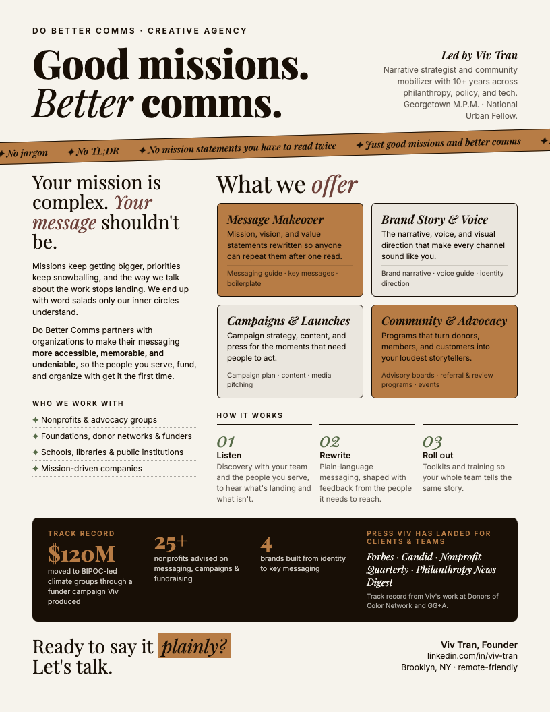
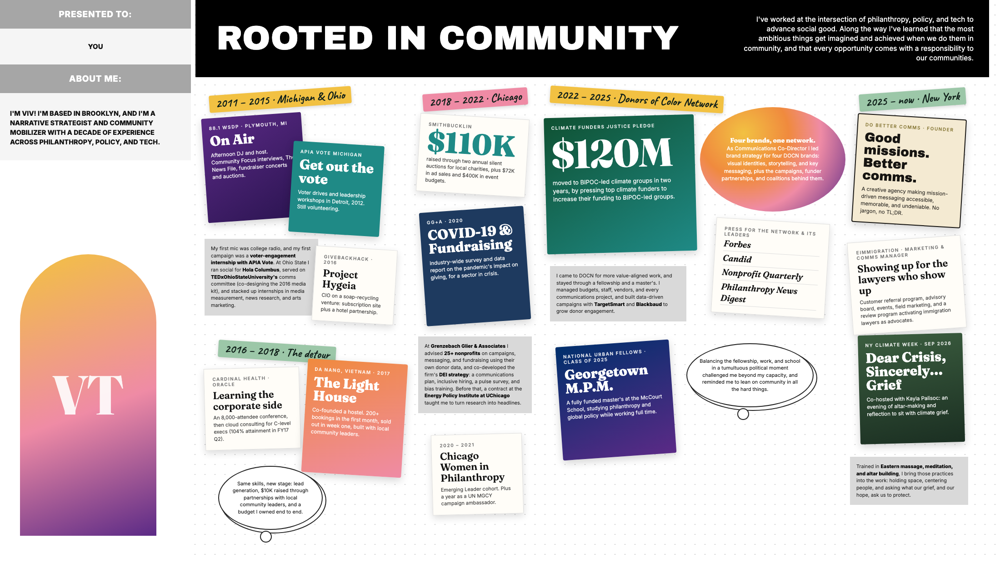

# Master Portfolio: Viv Tran

Narrative strategist and community mobilizer, Brooklyn, NY. Five ways into the same story.

| # | Piece | Open it | Source |
|---|-------|---------|--------|
| 1 | Spreadsheet resume | [`viv-tran-cv.xlsx`](spreadsheet-resume/viv-tran-cv.xlsx) | [`build_sheet.py`](spreadsheet-resume/build_sheet.py) |
| 2 | Microsite | [`microsite/index.html`](microsite/index.html) | same file |
| 3 | Creative resume | [`viv-tran-resume.pdf`](creative-resume/viv-tran-resume.pdf) | [`resume.html`](creative-resume/resume.html) |
| 4 | Consulting one-pager (Do Better Comms) | [`do-better-comms-one-pager.pdf`](consulting-one-pager/do-better-comms-one-pager.pdf) | [`one-pager.html`](consulting-one-pager/one-pager.html) |
| 5 | Experience board | [`experience-board.png`](experience-board/experience-board.png) | [`experience-board/index.html`](experience-board/index.html) |

<p>
  
  
</p>



## Palette

Every piece uses the Altarism brand colors, plus one complementary green:

| Altar Cream | Ember Black | Oxblood Clay | Marigold Amber | Dusk Plum | Incense Ash | Tulsi Green (added) |
|---|---|---|---|---|---|---|
| `#F6F3EC` | `#180F06` | `#6E413A` | `#B77C45` | `#755367` | `#AAA7A1` | `#566B47` |

Pages with dark panels also use light tints of these same colors so text stays readable.

## Photos and artifacts

- **Headshot:** add `assets/headshot.jpg`. The microsite, creative resume and experience board all pick it up automatically (they show a "VT" monogram until then).
- **Board artifacts:** drop real images into `experience-board/images/` using the file names listed in [its README](experience-board/README.md); each one replaces its colored card.

## Going live

With GitHub Pages turned on (Settings → Pages → Deploy from branch `main`, folder `/ (root)`), the root `index.html` forwards visitors to the microsite, and everything else is linkable under the same address.

## Regenerating the PDFs

The PDFs are printed from their HTML sources with Chrome:

```bash
"/Applications/Google Chrome.app/Contents/MacOS/Google Chrome" --headless=new --no-pdf-header-footer --virtual-time-budget=5000 --print-to-pdf=creative-resume/viv-tran-resume.pdf creative-resume/resume.html
```
